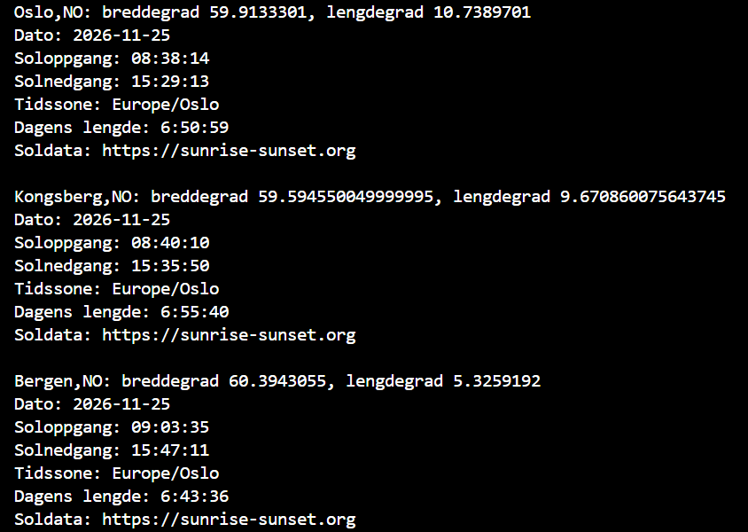

# Soltider med Python og API-er

## Endringer

### videreutvikling av prosjektet
## Felles kode for API-kall

Tidligere hentet og tolket "main.py" svarene fra begge API-ene. Nå håndterer
"ApiBase" HTTP-kallene og leser svarene som JSON. Hver API kode tolker
deretter dataene fra sin egen kilde.

- "GeoApi" lager en liste med "GeoData" objekter, ett for hvert sted som matcher etter søket. Hvert objekt inneholder bynavn og koordinater.
- "SunApi" samler soloppgang, solnedgang og tidssone for ett sted i et "SunData" objekt.

Dette gjør det enklere å endre hvordan programmet henter og leser data.
Tidsgrensen for begge API-kallene kan justeres ett sted, i "ApiBase".
Hvis OpenWeather endrer navnet på et koordinatfelt, holder det å oppdatere
"GeoData". Motor koden som leser soltidene, kan brukes som før.

Tolkingen av API-svarene kan også testes uten nettverk eller API-nøkkel.
"GeoApi" ble testet med to eksempelsteder for å sjekke at både Oslo og Bergen
kom med i resultatet. Til slutt ble hele programmet kjørt mot begge API-ene
for Oslo, Kongsberg og Bergen.

## Hva programmet gjør

Programmet henter koordinater og dagens soltider for Oslo, Kongsberg
og Bergen. Det viser breddegrad, lengdegrad, dato, soloppgang,
solnedgang, tidssone og dagens lengde i terminalen.

Programmet bruker to API-kilder:

1. OpenWeather Geocoding API henter koordinater fra bynavn.
   Dette API-et krever en personlig API-nøkkel.
2. Sunrise-Sunset API bruker koordinatene fra OpenWeather til å
   hente soloppgang og solnedgang. Dette API-et krever ingen nøkkel.

API-nøkkelen lagres med Python keyring og hentes ved kjøring.
Den ligger ikke i kildekoden.

### NB! Nøkkelen følger ikke med når prosjektet lastes ned fra GitHub.

## Instruksjonene nedenfor gjelder Windows. 
Åpne en terminal i prosjektmappen før du kjører kommandoene.

## Opprett et virtuelt miljø

py -m venv .venv

Kommandoen oppretter et eget Python-miljø i mappen .venv

## Installer pakkene

.\.venv\Scripts\python.exe -m pip install -r requirements.txt

Kommandoen installerer pakkene som står i requirements.txt.

## NB! Skaff og lagre egen API-nøkkel

Opprett en konto på https://home.openweathermap.org/users/sign_up,
bekreft epostadressen og finn nøkkelen under API keys.

Lagre nøkkelen på din egen PC:

.\.venv\Scripts\python.exe -m keyring set openweathermap api-key

Lim inn API-nøkkelen

## Kjør programmet

.\.venv\Scripts\python.exe main.py

Programmet skriver resultatene for de tre byene til terminalen.
Soltidene vises i tidssonen som returneres av Sunrise-Sunset.

